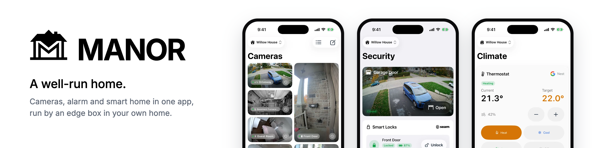

  

MANOR puts your cameras, alarm and smart home in one app. An edge box in your own home runs the cameras and devices, so live video stays on your network.

### Get started

- **App:** [iPhone and iPad](https://apps.apple.com/app/manor/id6751210823) · [Android](https://play.google.com/store/apps/details?id=click.mymanor.app)
- **MANOR Edge for Mac:** `brew install --cask getmanor/tap/manor-edge` ([tap](https://github.com/getmanor/homebrew-tap))
- **Agent skill:** [getmanor/skill](https://github.com/getmanor/skill) for skills.sh, Hermes and OpenClaw

[mymanor.click](https://mymanor.click)
